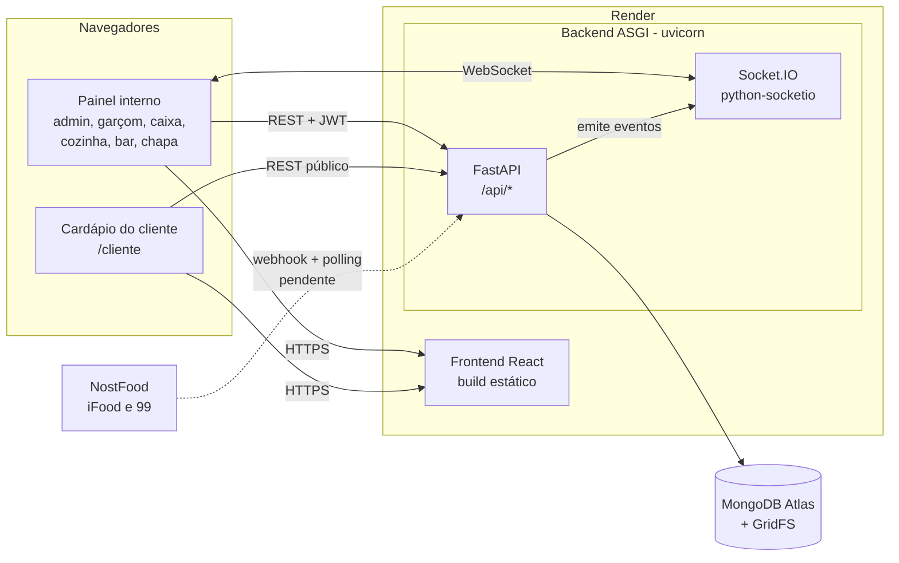
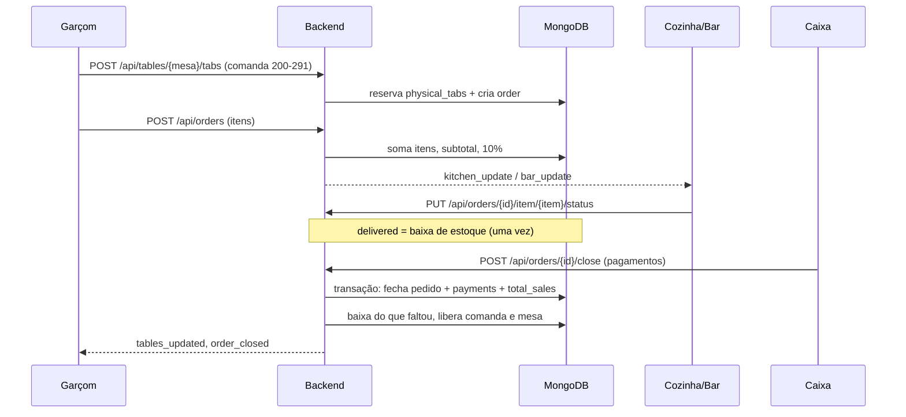

# Arquitetura

Estado descrito: branch `main` em 24/11/2026 (commit `4bf940a`). Itens de branches ainda não integradas estão marcados como **pendente**.

## Visão geral

O backend é um único processo ASGI: `server.py` cria o `FastAPI` e o embrulha em `socketio.ASGIApp`. O objeto servido pelo uvicorn é `server:app` (o ASGIApp). O FastAPI fica em `server.app.other_asgi_app`.

## Stack

| Camada | Tecnologia | Onde |
|---|---|---|
| API HTTP | FastAPI 0.110, Starlette 0.37, Pydantic 2 | `backend/server.py` |
| Tempo real | python-socketio 5 (ASGI), socket.io-client 4 | `server.py`, `frontend/src/lib/socket.js` |
| Banco | MongoDB Atlas via Motor 3.3 (pymongo 4.5) | `server.py` |
| Arquivos | GridFS (fotos das tarefas) | `backend/operational_modules.py` |
| Autenticação | JWT HS256 (python-jose), senha com bcrypt (passlib), validade de 24 h | `server.py` |
| Frontend | React 19, CRACO, Tailwind, shadcn/ui (Radix), axios, recharts | `frontend/` |
| Planilhas | openpyxl (exportação de relatórios) | `requirements.txt` |

### Arquivos do backend

| Arquivo | Papel |
|---|---|
| `server.py` | App, modelos, autenticação, quase todas as rotas e eventos Socket.IO |
| `financial_modules.py` | Taxa de serviço semanal e crédito de funcionários |
| `operational_modules.py` | Tarefas v2 com foto, histórico de notas e relatório avançado |
| `physical_tabs.py` | Faixa das comandas físicas (padrão 200 a 291) |
| `bootstrap.py` | `SECRET_KEY` obrigatória e criação do superadmin inicial |
| `sobre.py` | Nome, versão, autoria e commit (rota `/api/versao`) |
| `scripts/` | Diagnóstico e correção do caixa, comandas, usuários, exportação do OpenAPI |

## Coleções do MongoDB

Todos os documentos usam um campo `id` (UUID em texto) como chave de negócio. O `_id` do MongoDB nunca é devolvido pela API.

| Coleção | Conteúdo | Campos principais |
|---|---|---|
| `users` | Contas internas | `id`, `name`, `email`, `password` (hash bcrypt), `role`, `is_active`, `deactivated_at`, `deactivated_by_id` |
| `categories` | Categorias do cardápio | `id`, `name`, `type` (`food`/`drink`), `icon` |
| `products` | Produtos do cardápio | `id`, `name`, `category_id`, `price`, `cost`, `type`, `is_available`, `preparation_time`, `image_url` |
| `tables` | Mesas | `id`, `number`, `capacity`, `status` (`available`, `occupied`, `reserved`, `cleaning`), `table_type`, `note`, `current_order_id` |
| `physical_tabs` | Comandas físicas | `number`, `active_order_id`, `table_id` |
| `orders` | Pedidos do salão e online (mesma coleção) | `id`, `table_id`, `table_number`, `tab_number`, `items[]`, `status`, `subtotal`, `service_fee`, `service_fee_percentage`, `total`, `is_closed`, `closed_at`, `is_comp`, `comp_reason`, `source`, `origin`, `platform`, `settlement_*`, dados do cliente em pedidos online |
| `payments` | Pagamentos das comandas do salão | `id`, `order_id`, `amount`, `method`, `register_id`, `created_by_id` |
| `cash_registers` | Caixas (abertura e fechamento) | `id`, `opened_by`, `opened_by_id`, `initial_amount`, `deposits`, `withdrawals`, `total_sales`, `is_open`, `closed_at`, `final_amount`, `closing_report` |
| `cash_movements` | Sangrias e reforços | `id`, `register_id`, `type`, `amount`, `reason`, `created_by` |
| `stock` | Itens de estoque | `id`, `product_id` (opcional, legado), `name`, `category`, `stock_type`, `quantity`, `unit`, `min_quantity`, `max_quantity`, `unit_cost` |
| `recipes` | Receita (ficha de custo) por produto vendido | `id`, `product_id`, `ingredients[{stock_item_id, quantity}]` |
| `technical_sheets` | Ficha técnica de montagem (texto e foto) | `id`, `product_id`, `ingredients`, `assembly_steps`, `notes`, `image_url` |
| `production_recipes` | Fórmula de produção de semiacabados | `id`, `produced_stock_item_id`, `yield_quantity`, `ingredients[]` |
| `productions` | Registro de cada produção | `id`, `produced_stock_item_id`, `quantity`, `ingredients_consumed[]`, `total_cost`, `weighted_unit_cost`, `user_id` |
| `invoices` | Notas (status `mock` até haver emissor) | `id`, `order_id`, `number`, `status`, `total`, `customer_name`, `customer_cpf` |
| `settings` | Configurações (`_id` fixo): `restaurant_info`, `operations`, `fiscal`, `public_config` | dados do restaurante, operação, fiscal, configuração pública do cardápio |
| `order_counters` | Sequência do código do pedido online (`EM-0001`) | `_id: "public_order"`, `seq` |
| `employee_credit_employees` | Funcionários com crédito | `id`, `name`, `monthly_limit_cents`, `discount_pct`, `active` |
| `employee_credit_accounts` | Conta mensal do funcionário (índice único `employee_id` + `month`) | `limit_cents`, `charged_cents`, `paid_cents`, `transactions[]`, `voided_purchase_ids` |
| `operational_tasks` | Tarefas v2 (com foto) | `id`, `title`, `sector`, `task_type`, `frequency`, `due_on`, `due_time`, `assignee_id`, `events[]` |
| `operations_tasks` | Tarefas v1 (legado, sem foto) | `id`, `name`, `sector`, `status`, `completed_*` |
| `fs.files` / `fs.chunks` | GridFS: fotos das tarefas | metadados `task_id`, `submission_id`, `content_type` |

**Índices** (`backend/db_indexes.py`, criados na subida do servidor; uma falha só vai para o log):
`orders` (`is_closed`+`closed_at`, `created_at`, `table_id`+`is_closed`), `payments` (`order_id`, `register_id`, `created_at`),
`invoices` (`order_id`, `created_at`, `status`+`created_at`), `cash_registers` (`closed_at`) e `payment_reversals` (`order_id`).
Antes de qualquer índice único em `id`, rode `backend/scripts/verificar_duplicados.py` (somente leitura).

**Pendente (branch `feat/integracao-nostfood`):** `nostfood_events` (TTL de 30 dias), `nostfood_product_map`, `nostfood_unlinked`, `nostfood_tombstones`, `nostfood_settings` e `stock_losses`. Veja [integracoes/nostfood.md](integracoes/nostfood.md).

**Pendente (branch `fix/estoque-cmv`, PR #5):** registro das falhas de baixa de estoque e unidade na receita.

### Estrutura de um item de pedido (`orders.items[]`)

`id`, `product_id`, `product_name`, `quantity`, `unit_price`, `notes`, `type` (`food` vai para a cozinha, `drink` para o bar), `status` (`pending`, `preparing`, `ready`, `delivered`, `cancelled`), `is_courtesy`, `courtesy_reason`, `stock_deducted` (impede baixa em dobro) e, quando cancelado, `cancelled_qty`, `cancellation_reason`, `cancelled_by_*`, `stock_was_deducted`, `stock_restored`.

## Socket.IO

Servidor em `server.py` (`socketio.AsyncServer`, modo ASGI). O cliente (`frontend/src/lib/socket.js`) conecta na mesma URL do backend e reconecta sem limite de tentativas.

Na `main`, a conexão **não exige autenticação** e os eventos vão para **todos** os clientes conectados (broadcast). A branch `fix/cors-socket` (PR #4, aberta) exige token no Socket.IO e restringe o CORS.

### Eventos emitidos pelo servidor

| Evento | Quando | Conteúdo |
|---|---|---|
| `connection_established` | Ao conectar (só para quem conectou) | `{sid}` |
| `tables_updated` | Mesa ocupada, liberada, em limpeza, comanda vinculada, comanda fechada ou cancelada | Lista de mesas |
| `kitchen_update` | Item de comida lançado ou status de item alterado | Todos os pedidos abertos |
| `bar_update` | Item de bebida lançado ou status de item alterado | Todos os pedidos abertos |
| `order_updated` | Status de item alterado ou item cancelado | Pedido completo |
| `order_closed` | Comanda fechada, cancelada ou pedido online finalizado | `{order_id}` |
| `order_cancelled` | Cancelamento rápido | `{order_id}` |
| `new_online_order` | Pedido do cardápio público ou lançado manualmente no caixa | Resumo do pedido |
| `stock_updated` | Baixa ou devolução de estoque, produção | Lista do estoque |
| `stock_alert` | Item ficou no mínimo ou abaixo | Item, quantidade e mínimo |
| `waiter_notification` | Cozinha ou bar avisou que um item está pronto | Mesa, produto e mensagem |

### Eventos recebidos do cliente

| Evento | Efeito |
|---|---|
| `join_room` / `leave_room` | Entra ou sai de uma sala (`{room}`); hoje nenhuma emissão usa salas |
| `item_ready` | Repassa `waiter_notification` para todos |
| `request_cleaning` | Põe a mesa em limpeza (`{tableId}`) sem a checagem de comanda aberta que a rota HTTP faz |

## Perfis

| Perfil (`role`) | Nome na tela | Acesso |
|---|---|---|
| `superadmin` | Superadmin | Tudo. Único que cria, altera ou desativa outro superadmin |
| `admin` | Administrador | Tudo, menos mexer em superadmin |
| `waiter` | Garçom | Mesas, comandas, lançamento de itens, fichas técnicas (leitura), tarefas |
| `cashier` | Caixa | Caixa, fechamento, cortesia, pedidos online, notas, crédito de funcionário (lançar), tarefas |
| `kitchen` | Cozinha | Painel da cozinha e da chapa, status dos itens, fichas técnicas, tarefas |
| `bar` | Bar | Painel do bar, status dos itens, fichas técnicas, tarefas |

As regras ficam no backend (`require_role` em `server.py`); o frontend (`App.js`, `ProtectedRoute`) só esconde as telas. O superadmin passa em qualquer `require_role`. A tabela completa de permissões por rota está em [api.md](api.md).

O primeiro superadmin é criado no startup a partir de `INITIAL_SUPERADMIN_EMAIL` e `INITIAL_SUPERADMIN_PASSWORD`, só se ainda não existir nenhum (`bootstrap.py`). Não existe cadastro público.

## Fluxo de um pedido do salão

## Frontend

- `frontend/src/App.js`: rotas e `ProtectedRoute` por perfil. `/cliente/*` é público.
- `frontend/src/lib/api.js`: axios com `REACT_APP_BACKEND_URL` + `/api`, token JWT do `localStorage`, cache local de produtos, categorias e mesas e fila de pedidos offline.
- `frontend/src/lib/socket.js`: conexão Socket.IO e som de notificação.
- `frontend/src/components/Layout.js`: menu lateral, notificações e rodapé de autoria.
- `frontend/src/cliente/`: cardápio público do EMAÚS (tema próprio).
- `frontend/public/sw.js`: service worker (PWA).
