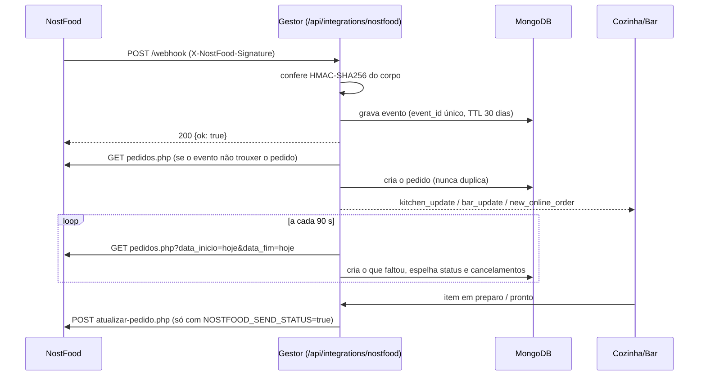

# Integração NostFood (pedidos do iFood e da 99)

> **Situação:** a integração **não está na `main`**. Está na branch `feat/integracao-nostfood`, em desenvolvimento.
> Este documento foi escrito lendo o código, sem executá-lo, no commit `2db0dc8` ("lê itens e valores do formato real do pedidos.php"). Esse commit existe na branch local e ainda não foi enviado para `origin/feat/integracao-nostfood` (que está em `a9aa556` e ainda lê o formato antigo, com `items` como lista). Arquivo principal: `backend/nostfood_integration.py`. Exemplo real anonimizado: `backend/tests/fixtures/nostfood_pedidos_reais.json`.

A NostFood junta os pedidos do iFood e da 99Food (e os pedidos feitos direto nela) e os entrega ao Gestor. O Gestor não fala direto com o iFood nem com a 99 nesta integração. Para a homologação direta com o iFood, veja [ifood-preparacao.md](ifood-preparacao.md).

## Como os pedidos chegam



- **Webhook** `POST /api/integrations/nostfood/webhook`: recusa se a integração estiver desligada ou sem segredo (503) e se a assinatura não bater (401). Assinatura: `X-NostFood-Signature: sha256=<HMAC-SHA256 do corpo bruto>`. Como a documentação da NostFood não diz se vem em hex ou base64, as duas formas são aceitas. Evento repetido (mesmo `event_id`) responde `{ok: true, duplicate: true}` sem processar de novo. O processamento roda em segundo plano depois da resposta.
- **Polling de segurança:** a cada `NOSTFOOD_POLL_SECONDS` (padrão 90, mínimo 30), busca os pedidos do dia no horário de São Paulo e, na virada da meia-noite, também os do dia anterior. Pagina por `limit=1000` e `offset` enquanto `has_more` for verdadeiro.
- **Sem duplicar:** índice único em `orders` por (`external_source`, `external_id`), trava por pedido e checagem dupla. Webhook e polling podem trazer o mesmo pedido sem problema.
- **Data de ativação:** na primeira vez que liga, grava `nostfood_enabled_at`. Pedidos criados na NostFood antes disso são ignorados. Pedido sem data de criação nunca é importado no primeiro polling.

### Endpoints da NostFood usados

| Uso | Chamada |
|---|---|
| Listar pedidos | `GET {NOSTFOOD_BASE_URL}/pedidos.php?data_inicio=AAAA-MM-DD&data_fim=AAAA-MM-DD&limit=1000&offset=N`, header `X-API-Key`. Resposta `{success, data: {pedidos: [...], has_more}}` |
| Atualizar status | `POST {NOSTFOOD_BASE_URL}/atualizar-pedido.php` com `{pedido_id ou order_number, status}`, header `X-API-Key` |

Não existe consulta de um pedido só: para achar um pedido, o Gestor busca o dia (e o anterior) e procura pelo `id` ou `order_number`.

## Formato real do pedido (`pedidos.php`)

No formato real, `items` **não é uma lista**: é um objeto. Os itens ficam em `items.itens_detalhados` e os valores em `items.totais`. Os campos `subtotal`, `delivery` e `total` do topo vêm como texto e são usados só como reserva.

Pedido da 99Food (dados do cliente, ids e horários trocados; estrutura e valores reais):

```json
{
  "id": 900001,
  "order_number": "99-5764700000000000001",
  "customer_name": "Cliente Fixture",
  "customer_phone": "16900000000",
  "customer_address": "Rua Fictícia",
  "customer_number": "1",
  "customer_neighborhood": "Bairro Teste",
  "customer_city": "Cidade Teste",
  "customer_state": "SP",
  "customer_cep": "00000-000",
  "customer_complemento": "",
  "items": {
    "totais": {
      "subtotal_bruto": 122.32, "subtotal": 122.32,
      "desconto_itens": 46.01, "desconto_entrega": 6.88, "desconto": 52.89,
      "entrega_bruta": 6.88, "entrega_liquida": 0, "delivery": 6.88,
      "taxa_servico": 4.2, "acrescimo": 4.2,
      "total_liquido": 80.51, "total": 80.51
    },
    "other_fees": {"service_price": 4.2, "coupon_discount": 28.89, "total_tip_money": 0, "small_order_price": 0},
    "other_fees_raw": {"service_price": 420, "coupon_discount": 2889, "total_tip_money": 0, "small_order_price": 0},
    "sponsorship_values": {"total_discount": 52.89, "shop_subside_price": 26.83, "platform_subside_price": 26.06},
    "promotions_raw": [
      {"promo_type": 2, "promo_discount": 2201, "shop_subside_price": 2201},
      {"promo_type": 11, "promo_discount": 2400, "shop_subside_price": 0},
      {"promo_type": 3, "promo_discount": 688, "shop_subside_price": 482}
    ],
    "food99_order_id": "5764700000000000001",
    "itens_detalhados": [
      {"nome": "Combo Amós", "preco": 49.5, "adicionais": [], "observacao": "", "produto_id": "", "quantidade": 1},
      {"nome": "Salomão - O Principe do Sabor", "preco": 36.41, "adicionais": [], "observacao": "", "produto_id": "", "quantidade": 2}
    ],
    "payment_raw": {"pay_type": 1, "pay_method": 1, "pay_channel": 212},
    "delivered_by": "MERCHANT", "delivery_type": 2, "handover_code": "0000", "locator": "FIXTURE"
  },
  "subtotal": "122.32",
  "delivery": "6.88",
  "total": "80.51",
  "status": "saiu_entrega",
  "payment_method": "pago_online",
  "created_at": "2026-11-24 12:00:00",
  "hora_aprovado": "2026-11-24 12:00:00",
  "hora_confirmado": "2026-11-24 12:00:00",
  "hora_preparado": null, "hora_pronto": null, "hora_enviado": null
}
```

Pedido feito direto na NostFood é mais simples: `items.totais` tem só `total`, `entrega` (em vez de `delivery`) e `subtotal`, e não há bloco de plataforma.

### Itens (`items.itens_detalhados`)

| Campo NostFood | No Gestor (`orders.items[]`) |
|---|---|
| `nome` | `external_name`; vira `product_name` se não houver ligação |
| `quantidade` | `quantity` (mínimo 1) |
| `preco` (+ adicionais) | `unit_price`. Se o item trouxer `subtotal`/`total`, usa total ÷ quantidade |
| `produto_id` | `external_item_id`. No formato real vem **vazio**: a ligação com o produto do Gestor cai no **nome** |
| `observacao` | `observation` e o começo de `notes` |
| `adicionais` (lista ou grupos com `opcoes`) | `addons` e "Adicionais: ..." em `notes` |

### Valores (`items.totais`)

O Gestor lê **primeiro** `items.totais` e, se faltar, o topo do pedido:

| No Gestor (`orders`) | Origem |
|---|---|
| `subtotal` | `totais.subtotal` → `subtotal` do topo → soma dos itens |
| `delivery_fee` | `totais.delivery` ou `totais.entrega` → `delivery`, `delivery_fee`, `taxa_entrega` ou `frete` do topo |
| `total` | `totais.total` → `total` do topo → subtotal + entrega |
| `service_fee`, `service_fee_percentage` | **sempre 0**: delivery não tem os 10% do salão |

Valores em texto são aceitos com vírgula ou ponto e com "R$".

### Descontos da loja e da plataforma, taxa de serviço

Os blocos financeiros `totais`, `other_fees`, `sponsorship_values` e `promotions_raw` são guardados **como vieram** em `orders.external_financials`. Hoje são **só registro**: não entram no caixa, no repasse nem nos relatórios. A API da NostFood não manda a comissão nem o valor do repasse.

Leitura do exemplo acima (interpretação a confirmar com a NostFood):

| Campo | Valor | Significado provável |
|---|---|---|
| `totais.subtotal_bruto` | 122,32 | Itens a preço cheio (49,50 + 2 × 36,41) |
| `totais.desconto_itens` | 46,01 | Desconto nos itens |
| `totais.desconto_entrega` | 6,88 | Entrega grátis para o cliente (`entrega_liquida` = 0) |
| `totais.desconto` = `sponsorship_values.total_discount` | 52,89 | Desconto total que o cliente recebeu |
| `sponsorship_values.shop_subside_price` | 26,83 | Parte do desconto **paga pela loja** (soma dos `shop_subside_price` de `promotions_raw`: 22,01 + 0 + 4,82) |
| `sponsorship_values.platform_subside_price` | 26,06 | Parte do desconto **paga pela plataforma** |
| `totais.taxa_servico` = `acrescimo` = `other_fees.service_price` | 4,20 | Taxa de serviço da plataforma cobrada do cliente. **Não** é a taxa de 10% do salão |
| `other_fees.coupon_discount` | 28,89 | Cupom aplicado (parte do desconto total) |
| `totais.total` = `total_liquido` | 80,51 | O que o cliente pagou: 122,32 + 6,88 − 52,89 + 4,20 |
| `*_raw` | centavos | Mesmos valores em centavos inteiros |

O `total` do pedido no Gestor é o **pago pelo cliente** (80,51), não o que a loja vai receber. A parte do desconto paga pela loja e a comissão da plataforma ainda não são descontadas em lugar nenhum.

### Plataforma de origem

O pedido no Gestor fica sempre com `platform = "nostfood"` (caixa e relatórios agrupam por NostFood). A plataforma real vai em `external_origin_platform`:

- algum campo com `food99` ou `99food` (ex.: `items.food99_order_id`) → `99food`;
- algum campo com `ifood` (ex.: `items.ifood_order_id`) → `ifood`;
- senão, `platform`/`plataforma`/`origem`/`canal` declarado;
- senão, `order_number` começando com `99-` → `99food`;
- senão, `null` (pedido direto na NostFood).

O id do pedido na plataforma (`food99_order_id` ou `ifood_order_id`) fica em `external_platform_order_id`.

### Outros campos

| Campo NostFood | No Gestor |
|---|---|
| `id` | `external_id` (texto) |
| `order_number` | `external_order_number` |
| `status` | `nostfood_status` |
| `customer_name`, `customer_phone` | `customer_name`, `customer_phone` |
| `customer_address`, `customer_number`, `customer_complemento`, `customer_neighborhood`, `customer_city`, `customer_state`, `customer_cep` | `customer_address` (objeto) e `address` (texto) |
| `latitude`, `longitude` | `latitude`, `longitude` |
| `payment_method` | `payment_method` e `payment_status` |
| `created_at` (`AAAA-MM-DD HH:MM:SS`, horário de São Paulo) | `external_created_at` |

O código também aceita os nomes alternativos em português (`itens`, `cliente.nome`, `endereco.rua`, `forma_pagamento`, `taxa_entrega`...), para o caso de a NostFood mudar o formato.

## Regras no Gestor

### Status

| Status na NostFood | Ao importar |
|---|---|
| novo, confirmado ou outro | Itens `pending`: aparece como novo no KDS, com som |
| `em_preparo`, `preparando` | Itens `preparing` |
| `pronto`, `saiu_entrega`, `enviado`, `entregue` | Itens `delivered`, vai direto para o histórico (sem som), com baixa de estoque |
| `cancelado`, `rejeitado` (e variações em inglês) | Cancelamento |

**Status de volta para a NostFood:** quando a cozinha põe algum item em preparo, o Gestor envia `em_preparo`; quando todos os itens ficam prontos, envia `pronto`. Só envia com `NOSTFOOD_SEND_STATUS=true`; desligado (padrão), só escreve no log o que teria enviado. O status enviado é anotado antes, e o `order.updated` que volta da NostFood é ignorado (sem laço). Falha no envio fica em `nostfood_sync_errors` do pedido.

### Pagamento: repasse ou cobrar na entrega

- `pix_online`, `cartao_credito_online`, `cartao_debito_online`, `mercadopago_online`, `pago_online` ou qualquer método terminado em `_online` → `payment_status = "pending_platform"`: repasse da plataforma, **fora da gaveta**.
- Qualquer outro método, ou nenhum → `payment_status = "to_collect"` (cobrar na entrega): o pedido fica aberto e entra no caixa pelo **fechamento normal**, e bloqueia o fechamento do caixa enquanto estiver aberto.
- Pedido entregue e pago online é fechado como repasse pendente (`settlement_status = "pending_platform"`).
- **Não recebido:** se o cliente não pagou na entrega, um admin marca `POST /pedidos/{id}/nao-recebido` com motivo. O pedido fecha fora das vendas e do caixa, e o custo vira **perda** em `stock_losses`.

### Produtos sem ligação

- A ligação NostFood → produto do Gestor fica em `nostfood_product_map`, por id (`id:...`) ou por nome normalizado (`name:...`, sem acento, sem diferença de maiúsculas e espaços).
- Item sem ligação **entra no pedido** e vai para a cozinha com alerta (`nostfood_alert`), mas não baixa estoque (fica com `stock_pending`). Fica listado em `nostfood_unlinked`.
- Ao ligar o produto (`POST /ligar-produto`), os pedidos ainda abertos são corrigidos (estação e estoque).

### Estoque

A baixa usa a mesma ficha técnica do salão, mas **nunca trava** o KDS nem o caixa: se falhar, o item fica com `stock_pending` e o motivo, e a operação segue. Pedido de teste nunca mexe em estoque.

### Cancelamento vindo da plataforma

- Item que **ainda não começou**: devolve a baixa, se houve.
- Item em preparo, pronto ou entregue: vira **perda** (baixa de estoque e custo em `stock_losses`), não venda.
- O KDS mostra o cancelado até cada tela (cozinha, bar) confirmar que viu, por até 12 horas.
- Cancelamento que chega **antes** do pedido grava uma "lápide" (`nostfood_tombstones`) e o pedido não é criado depois.
- Cancelamento depois de o pedido ser finalizado no Gestor só marca e alerta (`cancelled_after_close`) para conferência manual.

### Pedidos de teste

`POST /simular` cria um pedido falso só no Gestor (`is_test = true`), que nunca chama a NostFood, não mexe em estoque e não entra no caixa. `DELETE /testes` apaga todos os pedidos de teste e o que eles geraram. Webhook e polling nunca criam pedido de teste.

## Rotas (`/api/integrations/nostfood`)

| Método | Rota | Permissão | Descrição |
|---|---|---|---|
| POST | `/webhook` | assinatura HMAC | Recebe eventos `order.*` |
| GET | `/status` | admin | Ligada, chave e segredo configurados (sim/não), URL, intervalo, envio de status, último polling e erro |
| POST | `/simular` | admin | Pedido de teste |
| DELETE | `/testes` | admin | Apaga pedidos de teste |
| POST | `/pedidos/{id}/nao-recebido` | admin | Cobrar na entrega que não foi pago |
| GET | `/produtos-sem-ligacao` | admin | Itens que chegaram sem ligação |
| GET | `/ligacoes` | admin | Ligações existentes |
| POST | `/ligar-produto` | admin | `{product_id, nostfood_id ou nostfood_name}` |
| POST | `/pedidos/{id}/observacao` | admin, caixa | Observação nova para o KDS |
| POST | `/pedidos/{id}/observacao/{obs}/ciente` | admin, cozinha, bar | Tela confirma a observação |
| GET | `/kds/cancelados` | equipe | Cancelados aguardando confirmação (12 h) |
| POST | `/pedidos/{id}/cancelamento/ciente` | admin, cozinha, bar | Tela confirma o cancelamento |
| GET | `/perdas?data_inicio=&data_fim=` | admin | Perdas registradas e custo total |

## Variáveis de ambiente

| Variável | Padrão | Para quê |
|---|---|---|
| `NOSTFOOD_ENABLED` | `false` | Liga webhook, polling e status de volta |
| `NOSTFOOD_API_KEY` | (vazia) | Chave da API (`X-API-Key`). Sem ela não há polling nem envio de status |
| `NOSTFOOD_WEBHOOK_SECRET` | (vazia) | Segredo do HMAC. Sem ele o webhook é recusado |
| `NOSTFOOD_BASE_URL` | `https://nostfood.com/api/public` | Base da API |
| `NOSTFOOD_POLL_SECONDS` | `90` | Intervalo do polling (mínimo 30) |
| `NOSTFOOD_SEND_STATUS` | `false` | Envia `em_preparo` e `pronto` para a NostFood |

## Coleções novas

`nostfood_events` (eventos do webhook, apagados automaticamente após 30 dias), `nostfood_product_map`, `nostfood_unlinked`, `nostfood_tombstones`, `nostfood_settings` e `stock_losses`. Nenhuma coleção existente foi renomeada. Em `orders`, os pedidos da NostFood ganham `external_*`, `nostfood_*`, `payment_status`, `is_test`, `observations` e os campos de confirmação do KDS.

## Em aberto

- Usar `external_financials` no repasse: valor líquido esperado (total − parte da loja nos descontos − comissão).
- A comissão da plataforma não vem na API.
- Confirmar com a NostFood o significado de `promo_type`, `delivered_by`, `delivery_type` e `payment_raw`.
- Confirmar se a assinatura do webhook vem em hex ou base64.
